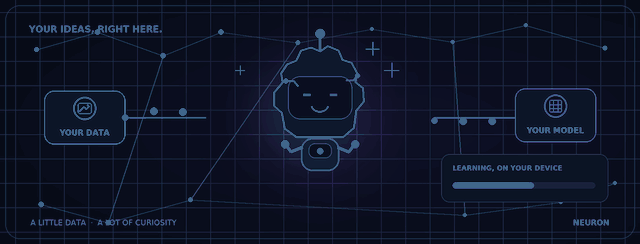

<p align="center">
  
</p>

<p align="center">
  <a href="#what-is-neuron"></a>
  <a href="#supported-studios"></a>
  <a href="#run-the-checks"></a>
  <a href="LICENSE"></a>
</p>

<p align="center"><b>Your idea.</b> Your data. Your device. <br>Bring examples, train a useful model, try it out—and keep control of every file.</p>

<p align="center">
  
</p>

<p align="center"><sub>Meet Nori: tiny robot, big curiosity. Everything in the loop stays in your browser unless you explicitly choose to share a model.</sub></p>

<p align="center">
  <a href="#quick-start">Get started</a> ·
  <a href="#your-first-model">Train a model</a> ·
  <a href="#privacy--data">Privacy</a> ·
  <a href="#developer-guide">Developer guide</a> ·
  <a href="#documentation-map">Documentation</a>
</p>

---

## What is NEURON?

**NEURON is a local-first machine-learning workbench that runs in your browser.** Organize your own examples, train and evaluate bounded models on your device, make predictions, compare versions, and export only when you decide to.

It is designed to make a first model approachable—not to pretend every problem needs a huge cloud AI model.

| Bring your own… | Build with… | Keep control with… |
|:--|:--|:--|
| Images, CSV tables, text, audio, video, or a supported custom model | Real feature extraction, training, evaluation, and prediction in the browser | Local browser storage, explicit imports/exports, private backups, and opt-in sharing |

**No account is required.** Dataset ingestion, training, and prediction do not upload your dataset to a NEURON server. There are important, clearly described exceptions for downloading the image encoder and for the sharing methods you explicitly choose—see [Privacy & data](#privacy--data).

## The real app, not a mockup

<p align="center">
  
</p>

<p align="center"><sub>Animated product tour · <a href="docs/screenshots/overview.jpg">Open the overview screenshot</a></sub></p>

## Supported studios

Open a studio from the app sidebar. Each one is a real, implemented workflow with explicit limits—not a promise of universal AI accuracy.

| Studio | What it does | What the model actually is |
|:--|:--|:--|
| **Images** | Create labeled projects, add images or explicitly capture a camera still, train, compare saved versions, predict, and export | MobileNet image features plus a trained classifier head using TensorFlow.js. Image model performance is reported on validation data; it is not an independent held-out test score. |
| **CSV studio** | Import a CSV, choose a task/target/features, train, review held-out metrics, predict one row or a batch, export a model or private backup | Regularized linear classification or regression with train-only preprocessing and grouped splits. See the [CSV guide](docs/tabular-guide.md). |
| **Text / audio / video** | Make a labeled project, add examples, train and evaluate, predict new inputs, switch model versions, export or back up | Text: signed hashed word-count features. Audio: bounded waveform/spectral features. Video: pooled features from six sampled frames. These are not language, speech-recognition, or action-understanding foundation models. |
| **Custom models** | Import a supported numeric model, inspect it locally, and run classification or regression predictions | Validated finite affine/linear JSON only—not executable scripts, TensorFlow/PyTorch checkpoints, or arbitrary ONNX graphs. Download the in-app template to start. |
| **Peer transfer** | Exchange offer/answer JSON manually, connect directly, send one selected model, verify its checksum, then explicitly import it as a new project | A real WebRTC data channel with bounded model-only transfer. No dataset transfer or always-works-through-every-firewall guarantee. |
| **Settings & storage** | Inspect local storage, review permissions/offline readiness, run read-only integrity checks, export or delete data | Storage inspection does not repair data or prove model quality. Keep your own backups. |

> [!IMPORTANT]
> NEURON trains **bounded models over documented feature representations**. It is not a foundation-model trainer, a universal AutoML search engine, a guarantee of accuracy, or a substitute for safety-critical validation. Read the [capability matrix](docs/capability-matrix.md) before choosing a studio.

## Your first model

### 1. Open NEURON

Either launch the hosted application from the URL supplied by your project owner, or run it locally with the [Quick start](#quick-start). Use a current desktop Chromium browser first for the most-tested experience. The browser must support IndexedDB, Web Crypto, Canvas, and module Workers. Camera and microphone APIs require HTTPS or `localhost`.

On the overview, choose **Start building** / **My projects** for images, **CSV studio** for a table, or the relevant studio in the sidebar. The app uses in-page hash navigation; ordinary page refreshes do not discard a route.

### 2. Prepare image examples

1. Create an image project and give it a clear name.
2. Add a few meaningful class labels (for example, `ripe` and `unripe`). Use distinct, consistently named labels.
3. Open each class and add representative JPEG, PNG, or WebP images. The importer normalizes images to a bounded size and rejects duplicates. Aim for a balanced variety of real examples—not many nearly identical copies.
4. Camera access is optional. It starts only after you explicitly request it; capture a still frame when ready. If permission is denied, use file upload instead.
5. When the first image model needs its encoder, download/install the verified image encoder pack while online. It is a separate download from the app shell. Wait for the pack before expecting image feature extraction to work offline.

### 3. Train, inspect, and predict

1. Open the project’s **Train** workflow and review the available dataset and training settings.
2. Start training and let the real browser job finish. Stay on the page while it runs; hardware speed and memory affect duration.
3. Read the evaluation report and error messages. Treat scores as evidence about your examples—not as a promise about new environments or future inputs.
4. Save model versions, switch/compare them, and test new examples in **Predict**.
5. Export a model only when you choose. A model-only file excludes raw image examples, but its labels and learned weights can still be sensitive.

The image workflow uses validation performance rather than an independent final test set. Do not describe it as unbiased held-out test accuracy.

### 4. Train from a CSV

1. Prepare a UTF-8, comma-separated file with one unique header row. Review [CSV studio — full operational guide](docs/tabular-guide.md) before using sensitive or large data.
2. Create a tabular project, select **classification** or **regression**, choose the target column, and choose 1–30 input features.
3. For classification, use 2–20 labels with at least 10 distinct feature groups per class. Regression requires at least 30 distinct feature groups. Remove IDs, target-derived columns, and other leakage yourself.
4. Inspect column profiles and choose numeric/categorical handling. Configure training, review the test/validation report, then predict a row or upload a batch.
5. Export a model-only artifact, or—with explicit consent—download a full backup containing raw CSV data.

CSV limits include a 16 MB source file, at most 25,000 nonempty records and 100 columns. Exact-feature groups are kept together across splits to reduce leakage; this cannot detect semantic, chronological, household, patient, or other relationships you have not supplied.

### 5. Work with text, audio, and video

1. Open **Text / audio / video** and create a project with a modality and 2–20 labels.
2. Add examples under the correct label. Text examples are added from lines; audio/video use files. Microphone recording is an explicit optional audio input.
3. Gather at least 10 distinct feature groups per label. Review examples and remove mislabels before training.
4. Train, check the validation/test report available to the studio, choose a saved version, and try unseen input using **Predict**.
5. Export just the model, or confirm the warning and create a full private backup if you need the raw media/examples too.

The current bounded extractors are deliberately modest: text uses 26 signed hashed word-count features; audio uses decoded waveform and fixed spectral features for short clips; video samples six frames and pools fixed color/texture/temporal features. Browser codecs vary. This is not speech-to-text, a language model, object tracking, or general video understanding. The media project cap is 2,000 examples / 32 MB raw data; clip duration, decoding and model limits are enforced in-app.

### 6. Use a custom model or transfer a model

- **Custom models:** download the app’s JSON template, provide a supported finite affine/linear model, then import and validate it. Inputs are bounded numeric features. Arbitrary code or model graphs are never executed.
- **Peer transfer:** the sender and receiver manually exchange signaling JSON over a trusted channel. Both people must stay online with the app open. The sender chooses a model and explicitly sends it; the receiver reviews and imports it as a new project. Signaling reveals network metadata to the peer and any ICE services. Connectivity may need a trusted STUN/TURN service and can still fail.
- **Encrypted share links:** this is a separate, optional image-model relay feature. It requires an operator to deploy and configure the fail-closed relay. The web app alone does not provide the relay; see [relay deployment](infra/relay-deployment.md). Never assume this feature is live just because the UI exists.

## Privacy & data

- **Local by default:** project data is stored in the browser’s origin-scoped IndexedDB. Training and prediction run in the browser; no account or analytics is required.
- **Origin matters:** changing scheme, host, port, or browser profile creates a different storage location. Use model export or a private backup to move data.
- **Explicit network use:** the first image encoder download contacts its configured model hosts. Encrypted image sharing contacts the operator-configured relay. WebRTC signaling/connectivity contacts the peer and any ICE/STUN/TURN services you configure. These can expose network metadata.
- **Backups are private files:** full project backups include raw examples and are **not encrypted**. Store them carefully. Deleting data from NEURON cannot revoke copies you already downloaded or shared.
- **Model-only does not mean anonymous:** model files exclude the raw dataset in supported formats, but can reveal labels, features, learned weights, or training-derived information.
- **Browser storage is not archival:** storage can be cleared or evicted, and private browsing may reduce persistence. Export important data before resetting a browser or device.

Read [PRIVACY.md](PRIVACY.md), [Data lifecycle](docs/data-lifecycle.md), and the [Threat model](docs/threat-model.md) for full boundaries and caveats.

### Offline use

The production build can cache the app shell and its emitted workers. Open the production origin online, then wait until **Settings & storage** reports the shell is ready; reload before testing offline. The image encoder pack is a separate dependency and must be installed first. Sharing features need network connectivity. Development mode intentionally does **not** install the service worker.

See [Offline strategy](docs/offline-strategy.md) and [Browser support](docs/browser-support.md).

## Quick start

### Requirements

- Node.js **22.12 or newer**.
- pnpm **9.15.5** (declared in `package.json`).
- A modern browser. Chromium is the automated browser-test target; real camera/microphone hardware and every mobile browser are not certified by the automated suite.

### Install and run

From the repository root:

```bash
# Install exactly from the checked-in lockfile (works without a global pnpm install)
npx --yes pnpm@9.15.5 install --frozen-lockfile

# Start the Vite dev server (http://localhost:5173)
npx --yes pnpm@9.15.5 dev
```

Open the printed localhost URL. No application API key or cloud-training account is required for local model training. The optional `NEURON_RELAY_TARGET` in `.env.example` is only a local development proxy target for encrypted image sharing; it is not required for the browser app and does not provision a relay.

### Production preview

```bash
npx --yes pnpm@9.15.5 build
npx --yes pnpm@9.15.5 --filter @neuron/web preview --host 0.0.0.0 --port 4173 --strictPort
```

Open `http://localhost:4173`. `pnpm build` builds both the web app and the optional relay worker bundle; it does **not** deploy either one.

## Developer guide

### Useful commands

```bash
pnpm check:env          # Validate Node/pnpm and optional local relay settings
pnpm check:boundaries   # Check browser/source import boundaries
pnpm typecheck          # Type-check web and relay
pnpm test               # Run web and relay unit tests
pnpm build              # Production-build web and relay bundle
pnpm test:e2e           # Playwright browser suite
pnpm release:check      # Release checks; reports if browser gate was skipped
pnpm release:check --browser  # Full release gate, including Chromium
```

For the browser gate, install Chromium first:

```bash
pnpm --filter @neuron/web exec playwright install chromium
# On Linux CI, install the browser's OS dependencies too:
pnpm --filter @neuron/web exec playwright install --with-deps chromium
```

The release checks do not deploy, create cloud services, or certify every real-world browser/device. Tests use synthetic camera/microphone devices where appropriate. A successful test suite does not prove generalization, regulatory compliance, security certification, or model quality on your data.

### Project map

```text
apps/web/                 React + TypeScript + Vite browser application
  src/app/                App shell, hash router, route parsing
  src/features/           Image, CSV, media, custom-model, sharing, settings workflows
  src/pages/               Workspace screens
  src/pwa/                 Service worker and offline asset management
services/relay/            Optional Cloudflare Worker for encrypted image shares
contracts/                 Documented runtime-format contracts
infra/                     Optional relay deployment notes/configuration
scripts/                   Environment, boundary, and release checks
 tests/                     Cross-workspace test fixtures
 docs/                      Capability, privacy, testing, browser, and deployment guides
```

The browser app is a static Vite build. No API secrets are needed for its normal local-first workflows. The optional relay is a separate Cloudflare Workers/R2/Durable Objects deployment and stays fail-closed until an operator provisions and configures it.

### Deploy the web app

Vercel can build the repository using the checked-in root `vercel.json`:

- **Framework:** Vite
- **Install:** `pnpm install --frozen-lockfile`
- **Build:** `pnpm build`
- **Output directory:** `apps/web/dist`
- **Root directory:** repository root
- **Required app secrets:** none for the web app

The deployment serves the web app; building `services/relay` does not deploy or enable the relay. Use [docs/deployment.md](docs/deployment.md) and [relay deployment notes](infra/relay-deployment.md) for the full operator procedure. Production access protection, secure-context APIs, response headers, and service-worker caching still need to be checked at the host.

## Troubleshooting

| What you see | What to check |
|:--|:--|
| The app opened but the page is blank or assets fail | Use the required Node/pnpm versions; rerun `pnpm install --frozen-lockfile`, then `pnpm build`. Check browser console errors and serve the Vite `dist` output with correct JS/module MIME types. |
| Camera or microphone is unavailable | Use HTTPS or `localhost`, grant browser permission, and explicitly start capture. File import remains available when capture is denied or unsupported. |
| Image training says the encoder is missing | Go online and install the verified image encoder pack; the offline app shell does not include that separately downloaded model asset. |
| Training is slow, memory-limited, or reports poor results | Try fewer/smaller examples, close other heavy tabs, check label balance and data quality, and use the actual evaluation report. Do not infer accuracy from a successful build or synthetic test. |
| An audio/video file is rejected | Try a short file with a codec the browser can decode; current clip-duration, size, pixel, and codec limits are intentional. |
| A project disappeared after moving browser/device/site | Local IndexedDB is isolated by browser profile and origin. Restore a private backup or import a model into a new project. |
| A peer transfer never connects | Keep both pages open, exchange signaling over a trusted channel, inspect firewall/NAT constraints, and configure a trusted ICE/TURN service only if you accept its network-metadata/privacy implications. Connectivity is not guaranteed. |
| Encrypted image share cannot reach `/api/shares` | The relay is optional. Deploy/configure the Cloudflare relay and same-origin route; the default production setup fails closed. |

## Documentation map

- [Capability matrix](docs/capability-matrix.md) — exactly what is implemented and its limits.
- [CSV studio guide](docs/tabular-guide.md) — parsing, features, splits, metrics, backups, and privacy.
- [Product requirements](docs/product-requirements.md) — product behavior and local-first boundaries.
- [Data lifecycle](docs/data-lifecycle.md) · [Privacy](PRIVACY.md) · [Threat model](docs/threat-model.md).
- [Offline strategy](docs/offline-strategy.md) · [Browser support](docs/browser-support.md) · [Accessibility](docs/accessibility.md).
- [Model formats](docs/model-format.md) · [Sharing protocol](docs/sharing-protocol.md).
- [Deployment](docs/deployment.md) · [Relay deployment](infra/relay-deployment.md).
- [Testing strategy](docs/testing-strategy.md) · [Release checklist](docs/release-checklist.md) · [Phase 6 audit](docs/phase6-audit.md).
- [Changelog](CHANGELOG.md) · [Contributing](CONTRIBUTING.md) · [Security reporting](SECURITY.md).

## License and distribution

This source repository is marked **UNLICENSED**; the rights holder has not selected an open-source license. Do not assume permission to redistribute or sublicense it. Third-party libraries and assets keep their own licenses. See [LICENSE](LICENSE) before publishing or redistributing.

---

<p align="center"><sub>NEURON · BUILD · TRAIN · EVOLVE</sub><br><sub>Your AI. Your device. Your control.</sub></p>
