<div align="center">



<br/>

<p>
  
  
  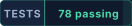
  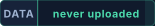
</p>
<p>
  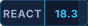
  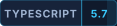
  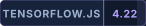
  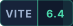
  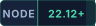
  
</p>

**A private, local-first machine-learning studio that runs entirely in your browser.**
Import your images → train a real classifier on your own device → predict, version, back up and (optionally) share an encrypted model.
No account. No cloud training. No sample uploads.

<a href="#quickstart"><b>Quickstart</b></a> ·
<a href="#what-actually-works-today">What works</a> ·
<a href="#honest-limits--please-read-before-judging">Limits</a> ·
<a href="#how-it-works">How it works</a> ·
<a href="docs/sharing-protocol.md">Sharing protocol</a>

</div>

---

> **IMPORTANT · PROJECT STATUS**
>
> ### This project is **under way** — not finished
> NEURON is being built in phases. **Phase 1, 2 and 3 are implemented, built and tested** (image classification, offline packs, backups, reviewed evolution, encrypted model links).
> **Phases 4–6 are not written yet** — text, audio, video, tabular and custom-modality training are shown in the UI only as *Later phase* placeholders.
> Nothing in this repository is faked: there are no simulated training timers, no random metrics and no hosted-AI API calls. If a feature is missing, this README says so.

---

## Live UI tour — real screen recording, not a mockup

<div align="center">
  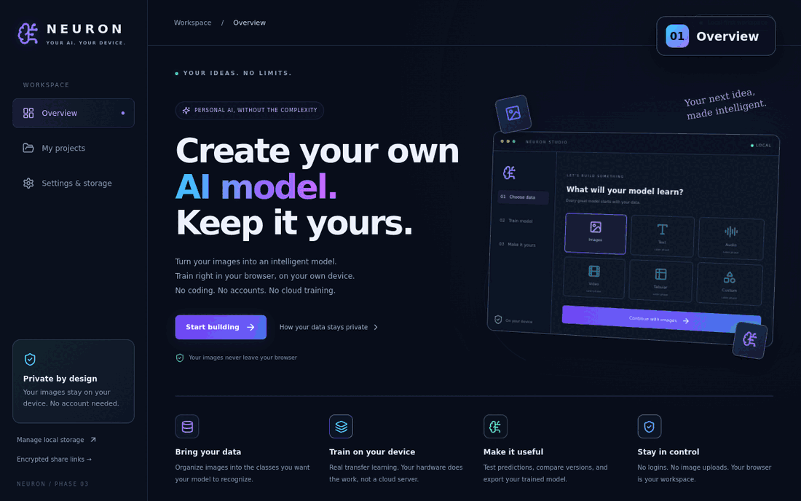
  <sub><b>01</b> Overview → <b>02</b> new project → <b>03</b> dataset → <b>04</b> training live → <b>05</b> model saved → <b>06</b> prediction from a real saved model</sub>
</div>

> Every frame above was captured from this exact source tree running locally (Chromium, software WebGL).
> The classifier was trained on 16 generated leaf images for 12 epochs; the final prediction shown is **86.7 %** on an unseen image — a real softmax output, not a designed screenshot.

---

## Screens

<table>
<tr>
<td width="50%">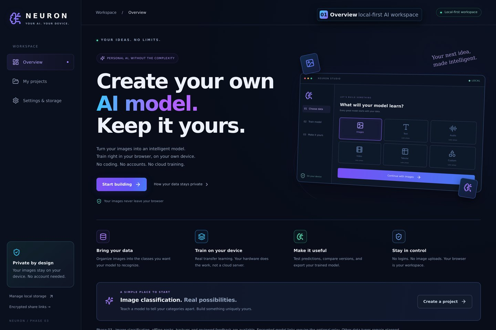<br/><sub><b>Overview</b> — the local-first workspace</sub></td>
<td width="50%">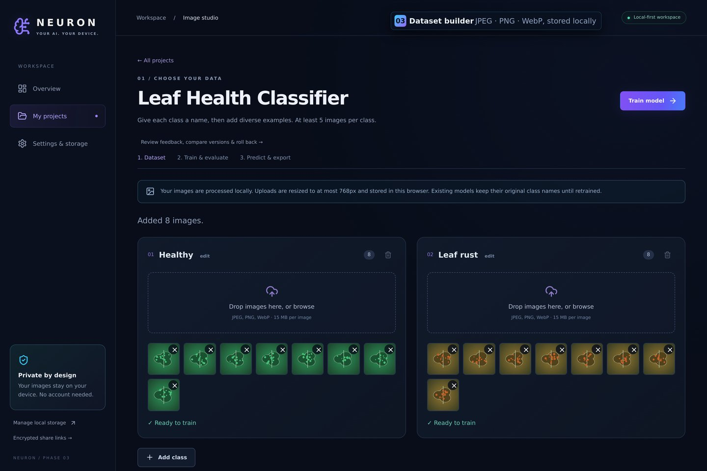<br/><sub><b>Dataset</b> — 2–20 classes, per-class counts, local storage</sub></td>
</tr>
<tr>
<td width="50%">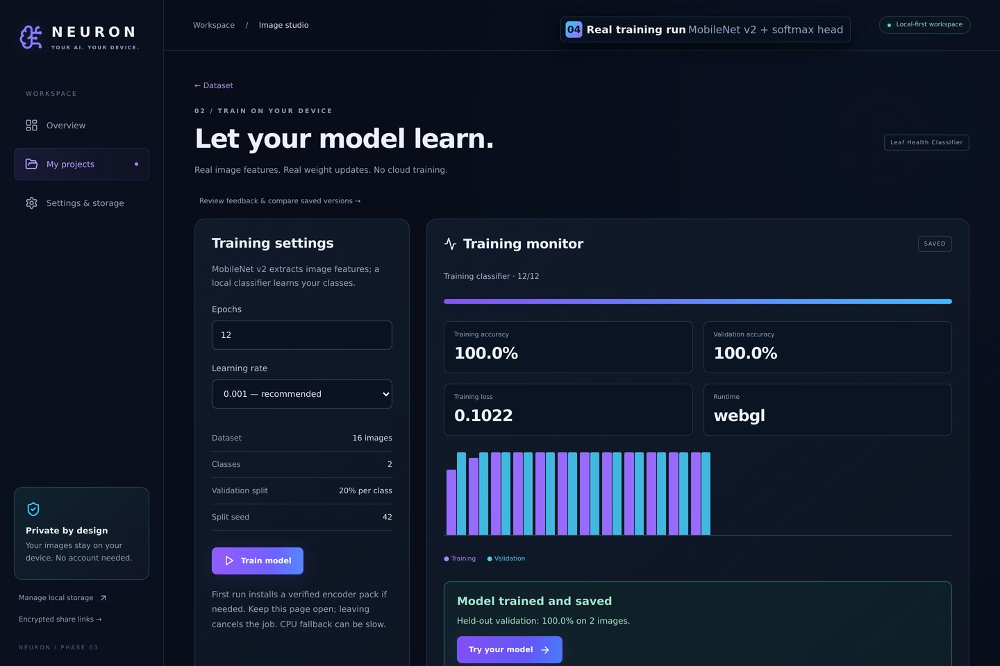<br/><sub><b>Training</b> — real loss/accuracy, epoch chart, confusion matrix</sub></td>
<td width="50%">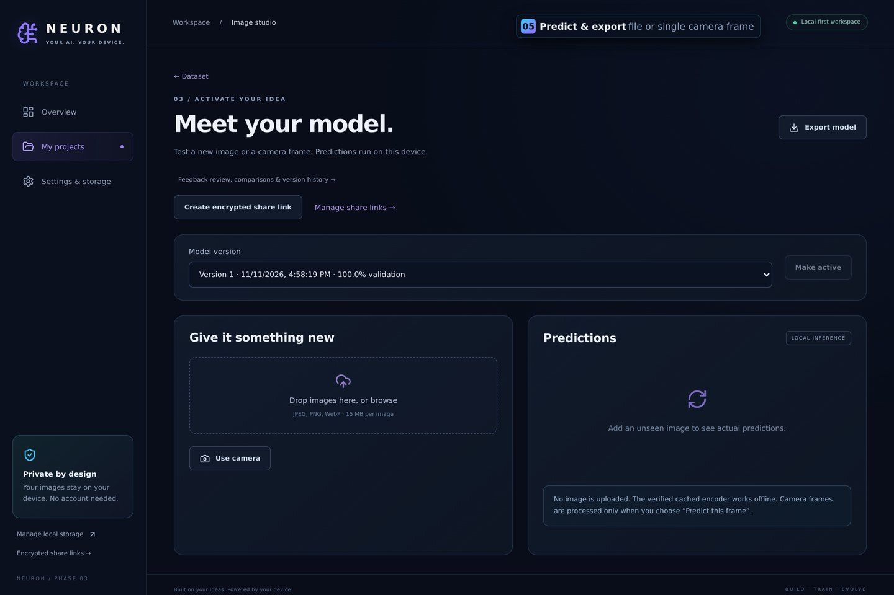<br/><sub><b>Predict</b> — file or single camera frame, scores + timing</sub></td>
</tr>
<tr>
<td width="50%">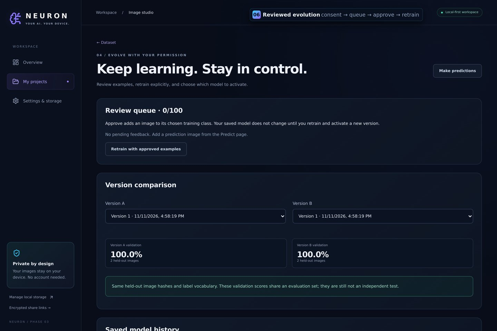<br/><sub><b>Evolve</b> — consent → queue → approve → retrain → roll back</sub></td>
<td width="50%">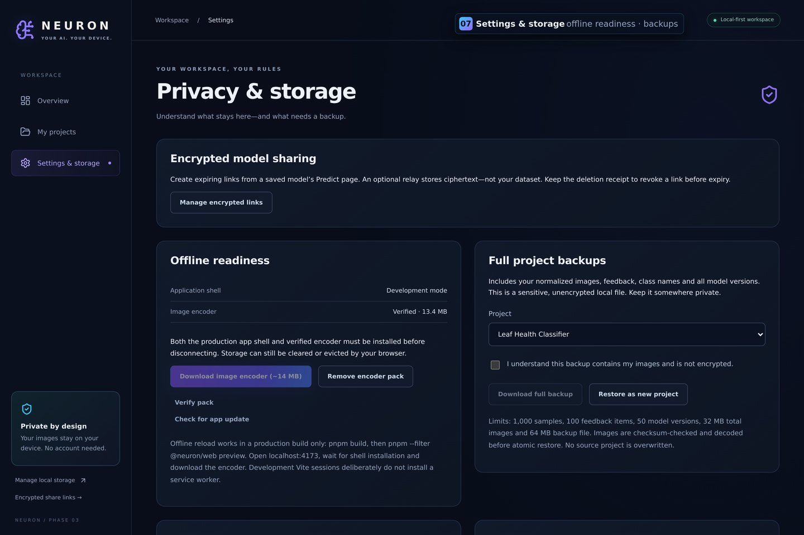<br/><sub><b>Settings</b> — offline readiness, storage estimate, backups</sub></td>
</tr>
<tr>
<td width="50%">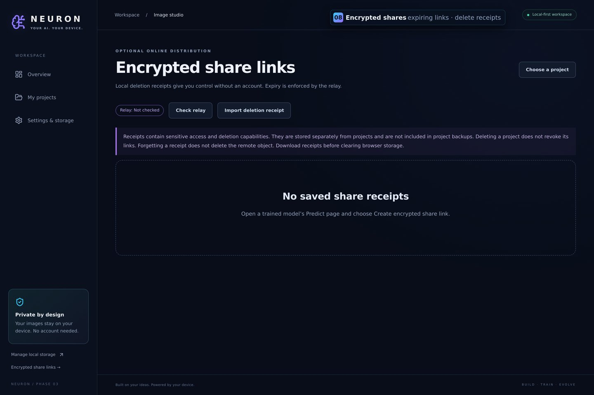<br/><sub><b>Shares</b> — expiring encrypted links + deletion receipts</sub></td>
<td width="50%">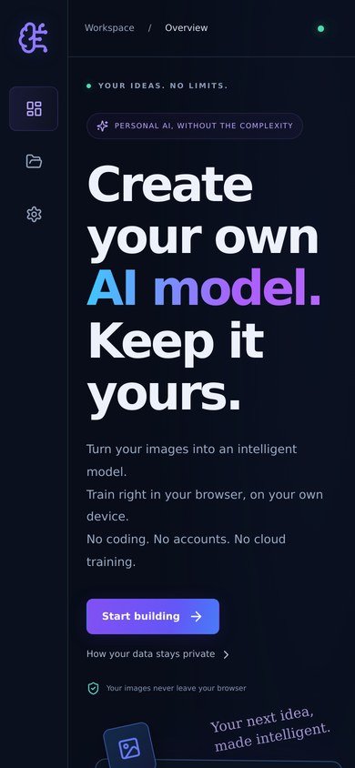<br/><sub><b>Mobile</b> — 390 px layout, no horizontal overflow</sub></td>
</tr>
</table>

---

## What actually works today

| Area | Status | Reality check |
|---|:---:|---|
| Local projects (create / rename / delete) | **Works** | IndexedDB `neuron-local`, version 2 schema |
| Dataset builder, 2–20 classes | **Works** | JPEG / PNG / WebP, normalized to ≤ 768 px, max 15 MB per file, ≤ 1,000 samples |
| Real transfer learning | **Works** | Frozen MobileNet v2 encoder (1,280 features) + trainable softmax head, TensorFlow.js |
| Training monitor | **Works** | Real epoch loss/accuracy, seeded 20 % stratified validation split, cancellation |
| Evaluation | **Works** | Confusion matrix + per-class scores (validation, **not** an independent test score) |
| Model versions | **Works** | Immutable versions, explicit activate / roll back |
| Prediction | **Works** | Saved-file inference and one-shot camera frame (`Predict this frame`) |
| Model export / import | **Works** | Validated `.neuron.json`, strict tensor names/shapes, no executable graph import, no images inside |
| Offline app shell | **Works (production build)** | Build-generated service worker, precaches lazy routes; **not** installed by `pnpm dev` |
| Offline encoder pack | **Works** | 5 pinned MobileNet files (~14 MB), streamed download, SHA-256 verified, cancel + one-pointer commit |
| Full project backup / restore | **Works** | Images + classes + all versions + feedback; verified hashes, restores as a **new** project (never overwrites) |
| Reviewed evolution loop | **Works** | Explicit consent stores a wrong prediction; approve → dataset, discard → delete; retrain manually |
| Honest version comparison | **Works** | Warns when validation fingerprints differ or metadata is absent |
| Encrypted model links | **Works locally** | AES-256-GCM in-browser, Cloudflare Worker + R2 + Durable Object relay, expiry, revoke by token |
| Text / audio / video / tabular / custom | **Not built** | Home-page tiles are decorative and labelled *Later phase* |
| P2P / WebRTC transfer | **Not built** | Planned, not simulated |
| Worker-isolated training | **Not built** | Training runs on the main thread, async-yielding |
| Cloud deployment | **Not performed** | The relay is exercised locally with Miniflare only |

---

## How it works

<div align="center">
  
</div>

```text
Image ──► normalize (≤768px JPEG) ──► MobileNet v2 frozen encoder ──► 1,280-d feature vector
                                                                              │
                                              softmax head (trainable) ◄──────┘
                                                       │
                            seeded stratified split ───┤ 80 % train / 20 % validation
                                                       ▼
                        real loss + accuracy per epoch ──► confusion matrix
                                                       │
                                     IndexedDB (v2) ◄──┴──► immutable versions · activate · roll back
                                                       │
                    .neuron.json export  ──  full backup (images included)  ──  optional AES-256-GCM share link
```

**Privacy boundary:** your images are decoded, resized and stored in *your* browser. The only network traffic during normal use is `GET` requests for the encoder assets and static app files. Sharing a model is an explicit, opt-in action and uploads **ciphertext only**.

---

## Quickstart

**Requirements:** Node.js **22.12+** (tested on 22.23.4 — Phase 3 relay tooling requires Node 22), pnpm **9.15.5**. No `.env`, no API keys, no account.

```bash
git clone https://github.com/pandraladharmakovid-cyber/NEURON.git
cd NEURON

npm install --global pnpm@9.15.5   # if pnpm is missing
pnpm install

pnpm typecheck   # TypeScript, web + relay
pnpm test        # 78 tests (62 web + 16 relay)
pnpm build       # production web bundle + worker bundle

pnpm dev         # http://localhost:5173
```

Optional — **encrypted sharing** needs the relay in a second terminal:

```bash
pnpm dev:relay   # Miniflare on http://127.0.0.1:8787
```

> **TIP · OFFLINE TESTING**
>
> **Dev does not install the offline worker.** To try offline reload you must run a real production preview:
> `pnpm build && pnpm --filter @neuron/web preview --port 4173 --strictPort`, open <http://localhost:4173>, then in **Settings → Offline readiness** wait for *Application shell: Installed* and click *Download image encoder* until it reads **Verified**. Only then disconnect.

> **WARNING · STORAGE IS PER-ORIGIN**
>
> Browser storage is **origin-specific**. `localhost:5173`, `localhost:4173`, `127.0.0.1` and a deployed domain are four separate storage scopes. Export a full backup before moving origins, and reinstall the encoder pack on each one.

---

## Project structure

```text
NEURON/
├── apps/web/                     # React 18 + TypeScript + Vite SPA
│   ├── src/
│   │   ├── app/                  # App router (hash-based), ErrorBoundary
│   │   ├── components/           # AppShell, buttons, dialog, toast, dropzone
│   │   ├── features/
│   │   │   ├── projects/         # project creation + validation
│   │   │   ├── datasets/         # ingest, JPEG normalization, dedupe
│   │   │   ├── training/         # real TF.js training job
│   │   │   ├── inference/        # prediction + feedback capture
│   │   │   ├── evolution/        # compare, queue, version history
│   │   │   ├── settings/         # runtime + backup panels
│   │   │   └── sharing/          # crypto, format, client, receipts, UI
│   │   ├── lib/                  # db, types, ml, model/backup formats, checksums
│   │   ├── pages/                # 10 route pages
│   │   ├── pwa/                  # service worker, asset manager, update manager
│   │   ├── styles/               # tokens, global, phase2, phase3 CSS
│   │   └── test/                 # 9 Vitest suites
│   └── public/                   # manifest, favicon, offline.html, _headers
├── services/relay/               # Cloudflare Worker + R2 + Durable Object (Miniflare locally)
│   ├── src/                      # router, validation, object store, rate limit
│   ├── test/                     # 16 relay tests
│   └── wrangler.toml             # ships with uploads DISABLED (fail-closed)
├── docs/
│   ├── assets/                   # animated banner, WIP ribbon, pipeline, badges
│   ├── screenshots/              # captured from a real local run
│   ├── demo-tour.gif             # the animated tour above
│   ├── handoffs/                 # the original phase handoff bundles
│   └── sharing-protocol.md       # protocol v1: framing, API, limits, threat notes
└── pnpm-workspace.yaml           # apps/* · packages/* · services/*
```

---

## Feature deep-dives

<details>
<summary><b>The training actually trains — no fake progress bars</b></summary>

<br/>

- Backend preference is **WebGL**, with an honest **CPU fallback**; the runtime shown in the monitor is the one that was picked (`webgl` / `cpu`). WebGPU is *not* claimed.
- MobileNet v2 (`@tensorflow-models/mobilenet` 2.1.1) is used **frozen** as a feature extractor — 1,280 features per image.
- Only the dense softmax head is trained, with a real optimizer and real categorical cross-entropy.
- Minimum 5 images per class. A seeded (default `42`) stratified split holds out 20 % per class for validation.
- Metrics come straight from `model.fit` callbacks: epoch loss, epoch accuracy, validation loss, validation accuracy, then a confusion matrix.
- Jobs are cancellable; cancelling never damages the previously saved model version.
- Bias disclaimer baked into the UI: validation accuracy is **not** an independent test score and softmax scores are **not** calibrated probabilities.

</details>

<details>
<summary><b>Offline packs and the app shell</b></summary>

<br/>

- The Vite build generates `service-worker.js` and precaches every emitted asset, including lazy routes, plus `offline.html`, `favicon.svg` and the manifest.
- A failed new cache installation never replaces the active shell cache.
- Updates do not force `skipWaiting`. *Apply safe update* uses **Web Locks** so an active training / download / backup in another tab blocks the update.
- The encoder pack is exactly five pinned files (JSON + four weight shards, ~14 MB) with **SHA-256 and byte-size pins** taken from the real downloads. Each cached artifact is verified before use — corruption is reported, never silently accepted.
- Downloads stream with a byte budget, are cancellable and commit through a single pointer swap.

</details>

<details>
<summary><b>Backups, limits and evolution</b></summary>

<br/>

| Limit | Value |
|---|---|
| Samples per project | 1,000 |
| Classes per project | 2 – 20 |
| Queued feedback items | 100 |
| Model versions per project | 50 |
| Image payload in a backup | 32 MB |
| Backup JSON size | 64 MB |
| Encrypted share envelope | 8 MB + 64 bytes |
| Share link lifetimes | 15 min · 1 hour · 24 hours |

Restoring validates schema, shapes, image SHA-256, JPEG decoding and 768 px dimensions **before** an atomic write, and always creates a **new** project. A failed restore leaves existing projects untouched. Backups contain your images and are **not encrypted** — the UI requires explicit consent before exporting one.

The evolution loop is deliberately manual: a wrong prediction is only stored after you tick consent, then you review the queue, approve (moves into the dataset) or discard, and retrain yourself. There is no silent dataset collection and no automatic retraining.

</details>

<details>
<summary><b>Encrypted share links — optional, online</b></summary>

<br/>

1. A fresh AES-256-GCM key and an independent 256-bit deletion token are generated in the browser with the Web Crypto CSPRNG.
2. The model is sanitized to a whitelisted artifact, encrypted locally, and only the ciphertext is uploaded.
3. The encryption key lives in the URL fragment (`/#/receive/{id}/{key}`) — **fragments are never sent in HTTP requests**. The recipient page strips it from the address bar and keeps it in memory.
4. The relay stores ciphertext, a SHA-256 of the deletion token and an expiry; it can never decrypt. `DELETE` with the deletion token revokes early.
5. Receipts (link + deletion secret) live in a **separate** IndexedDB database, so deleting a project does not lose revocation access. They are not included in project backups — keep them private and separate.

Read the full details, threat notes and deployment checklist in [`docs/sharing-protocol.md`](docs/sharing-protocol.md).

**Not provided:** WebRTC/P2P, encrypted *dataset* backups, transfer of already-downloaded copies, or account recovery. The relay operator can withhold availability; anonymity is not guaranteed (IPs, timing and ciphertext size are visible).

</details>

---

## Verification performed on this exact tree

| Step | Command | Result |
|---|---|---|
| Install | `pnpm install` | ✅ clean, lockfile committed |
| Types | `pnpm typecheck` | ✅ web + relay, no errors |
| Tests | `pnpm test` | ✅ **78 passed** (9 web suites / 62 tests, 1 relay suite / 16 tests) |
| Build | `pnpm build` | ✅ web bundle + generated `service-worker.js` + relay worker bundle |
| Browser | Chromium 131, software WebGL | ✅ project → 16 images → real 12-epoch training → saved version → **86.7 %** prediction, no console errors |

**Known build warning (not a failure):** the TensorFlow chunk is ≈ 1.87 MB minified / ≈ 303 KB gzip, above Vite's 500 kB advisory. Train/Predict routes are lazy-loaded; further size work is a later task.

---

## Honest limits — please read before judging

- **Not the whole product.** Image classification is real; the other five modality tiles are labelled *Later phase* and do nothing.
- **Not offline-first by default.** Dev mode installs no service worker, and the encoder needs one download (~14 MB) per origin.
- **Not a benchmark.** 5 images/class is a functional minimum, not a useful model. Accuracy is validation accuracy, not a test score. A seed fixes split/init, not bit-for-bit determinism across GPUs.
- **Not a security audit.** Encryption is real, but no formal security review, accessibility audit, production hosting configuration or device certification has been performed.
- **Not deployed.** `wrangler.toml` fails closed with uploads disabled; no cloud resources, billing or credentials are created by this repo. Hosting infrastructure and `_headers` application remain explicit later tasks.
- **Storage can disappear.** Browser data can be evicted. Keep original images and exported backups outside the browser.

---

## Roadmap

```text
Phase 1  ████████████████████  Images: dataset, real transfer learning, versions, export
Phase 2  ████████████████████  Offline shell + verified encoder, full backups, reviewed evolution
Phase 3  ████████████████████  Encrypted expiring model links (Worker + R2 + Durable Object)
Phase 4  ░░░░░░░░░░░░░░░░░░░░  More modalities: text, tabular, audio
Phase 5  ░░░░░░░░░░░░░░░░░░░░  Worker-isolated training, independent test sets, resumable jobs
Phase 6  ░░░░░░░░░░░░░░░░░░░░  Deployment, security & accessibility audits, device matrix
```

Phase 4–6 are **not started**. No placeholder in the UI claims otherwise.

---

## Troubleshooting

| Symptom | Cause / fix |
|---|---|
| "Encoder unavailable…" | The ~14 MB encoder pack is not cached yet. Settings → Offline readiness → *Download image encoder*. |
| Offline reload fails | You are on the dev server (`:5173`). Use a production preview on a **different** port with the shell installed. |
| Projects vanished after changing port | Different origin ⇒ different storage. Restore from a full backup. |
| `A job is active in a NEURON tab` | Training / download / backup holds the Web Lock. Finish or cancel it, then retry the update. |
| Sharing returns `/api/shares` errors | The relay is not running. Start `pnpm dev:relay` (8787) next to `pnpm dev`. |
| `Secure updates require Web Locks` | Close **all** NEURON tabs and reopen. |
| Node engine error | Use Node **22.12+** (`node -v`). Phase 3 relay tooling refuses Node 20. |
| `dbh…` / `POSTGRES_*` env requests | Out of scope. NEURON stores data in IndexedDB; it does not use an external database. |

---

## Author

<div align="center">


### Pandrala Dharma Kovidh
**AI-focused developer · software builder · student**

Designed and built NEURON phase by phase — dataset pipeline, on-device training, offline packs,
backups, evolution loop and the encrypted sharing relay.

[](https://github.com/pandraladharmakovid-cyber)
[](https://github.com/pandraladharmakovid-cyber/NEURON)
[](mailto:pandraladharmakovid@gmail.com)

</div>

---

## License

No license file is included yet, so default copyright applies — the code is public to read, learn from and review, but re-use and redistribution rights are **not** granted until a license is added (a later task). Third-party model weights and libraries keep their own licenses: TensorFlow.js (Apache-2.0) and the MobileNet v2 weights served for `@tensorflow-models/mobilenet` — review their terms before redistribution.

<div align="center">
<br/>
<sub><b>NEURON</b> · Your AI. Your device. · Phase 3 of 6 · actively under construction</sub>
</div>
